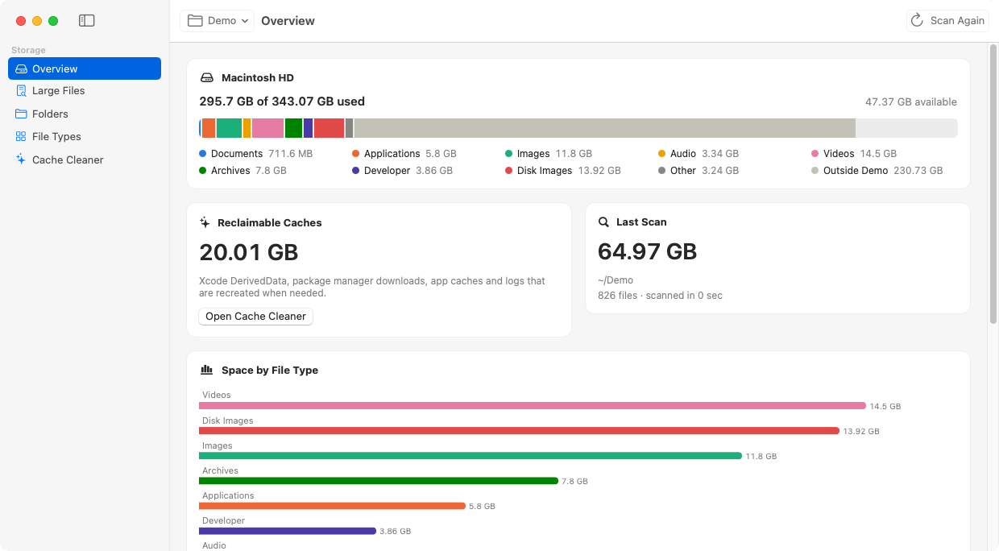
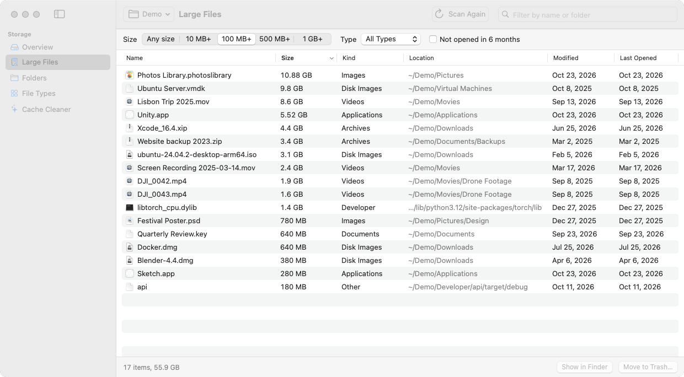
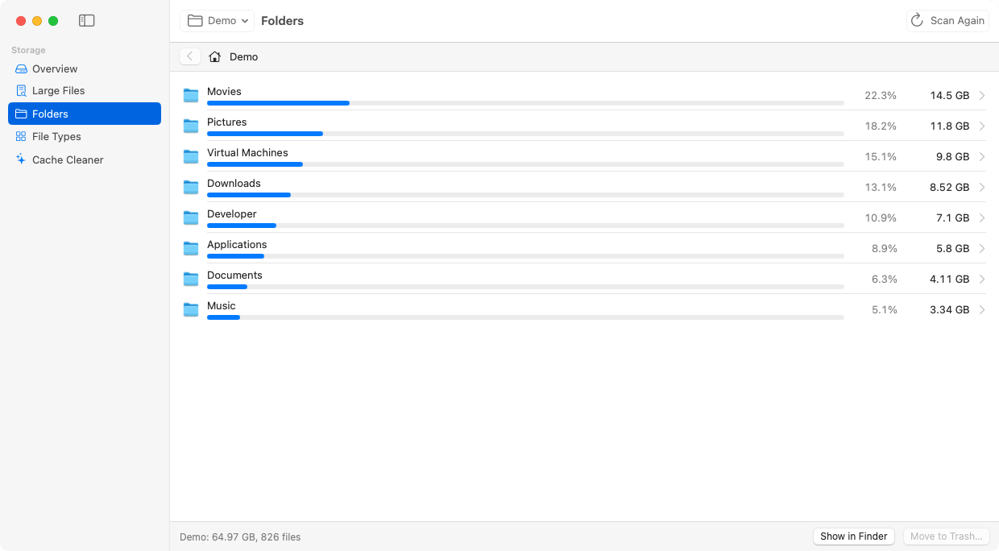
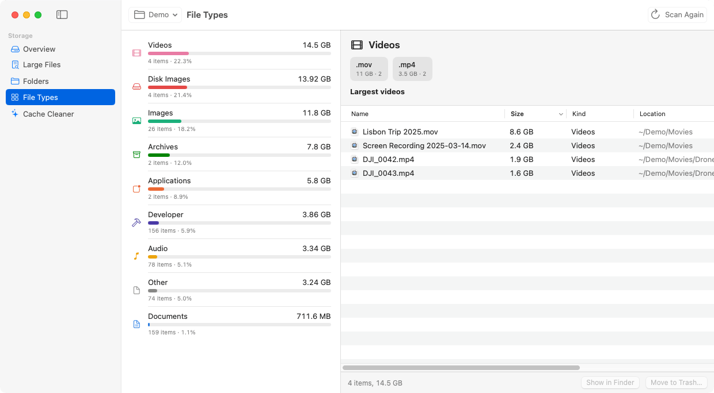
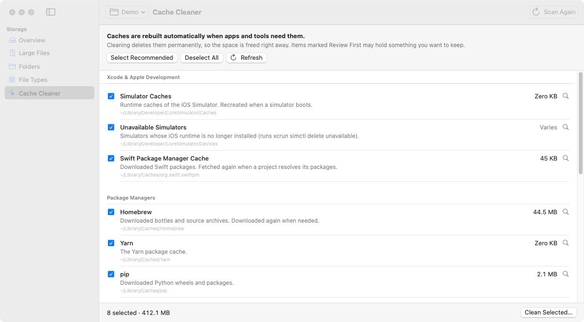

# Storage Optimizer

Native apps for **macOS** and **Windows 11** that show where your disk space went and clean caches safely.

> [!WARNING]
> This app deletes files and caches when you tell it to. Use it at your own risk and keep backups of anything important. See the [disclaimer](#disclaimer).

<picture>
  <source media="(prefers-color-scheme: dark)" srcset="docs/screenshots/macos/overview-dark.png">
  
</picture>

| | macOS | Windows 11 |
|---|---|---|
| Built with | SwiftUI and Swift Charts | WPF on .NET 10, with the Windows 11 Fluent theme (Mica, light and dark mode) |
| Runs on | macOS 14 Sonoma or later, Apple silicon and Intel | Windows 11 or Windows 10 (2004 or later), x64 and ARM64 |
| Download | [Latest release](https://github.com/ugokce/StorageOptimizer/releases/latest): `StorageOptimizer-<version>-macOS.zip` | [Latest release](https://github.com/ugokce/StorageOptimizer/releases/latest): `StorageOptimizer-<version>-Windows-x64.zip` or `-Windows-ARM64.zip` |
| Details | this page | [`windows/README.md`](windows/README.md) |

## Features

- **Overview**: a disk usage bar broken down by file type, like the Storage page in System Settings or Windows Settings. It also shows how much space caches are using and lists your largest folders and files.
- **Large Files**: a sortable table of the 2,000 largest files.
  - Filter by size (10 MB+ … 1 GB+), by type, by name, or to files not opened in 6 months.
  - Show items in Finder or File Explorer, open them, copy their paths, or move them to the Trash or Recycle Bin.
- **Folders**: browse the scanned folder tree, sorted by size, with a size bar and percentage per item. Files under 1 MB in each folder are grouped into one row.
- **File Types**: space per category (Videos, Images, Audio, Documents, Archives, Disk Images, Applications, Developer, Other), with the largest files and file extensions in each.
- **Cache Cleaner**: finds and measures caches that tools and apps rebuild by themselves, then deletes the ones you select.
  - Developer caches such as Xcode DerivedData on macOS and the Unity cache on Windows
  - Package manager and browser caches
  - Project build folders found by a scan, for example `node_modules`, Cargo `target` and Unity `Library`

You can scan your home or user folder, the entire disk or any drive, or any folder you choose.

## Screenshots

These come from the macOS app, scanning a demo folder. Windows screenshots are in [`windows/README.md`](windows/README.md#screenshots).

<table>
  <tr>
    <td width="50%">
      <picture>
        <source media="(prefers-color-scheme: dark)" srcset="docs/screenshots/macos/large-files-dark.png">
        
      </picture>
      <p align="center"><b>Large Files</b></p>
    </td>
    <td width="50%">
      <picture>
        <source media="(prefers-color-scheme: dark)" srcset="docs/screenshots/macos/folders-dark.png">
        
      </picture>
      <p align="center"><b>Folders</b></p>
    </td>
  </tr>
  <tr>
    <td width="50%">
      <picture>
        <source media="(prefers-color-scheme: dark)" srcset="docs/screenshots/macos/file-types-dark.png">
        
      </picture>
      <p align="center"><b>File Types</b></p>
    </td>
    <td width="50%">
      <picture>
        <source media="(prefers-color-scheme: dark)" srcset="docs/screenshots/macos/cache-cleaner-dark.png">
        
      </picture>
      <p align="center"><b>Cache Cleaner</b></p>
    </td>
  </tr>
</table>

<details>
<summary>Windows 11</summary>

<picture>
  <source media="(prefers-color-scheme: dark)" srcset="docs/screenshots/windows/overview-dark.png">
  
</picture>

</details>

## Getting the macOS app

For Windows, see [`windows/README.md`](windows/README.md#getting-the-app).

### Download a release

1. Open the [latest release](https://github.com/ugokce/StorageOptimizer/releases/latest) and download `StorageOptimizer-<version>-macOS.zip`. It runs on Apple silicon and Intel Macs.
2. Unzip it and move **Storage Optimizer.app** to `/Applications`.

The app is signed ad hoc rather than with a Developer ID, so macOS quarantines it after download. Clear the quarantine once:

```sh
xattr -dr com.apple.quarantine "/Applications/Storage Optimizer.app"
```

Alternatively, right-click the app, choose **Open**, then confirm in **System Settings › Privacy & Security**.

**Development builds:** every push that changes the Mac app runs the **macOS** workflow on GitHub Actions. To try the latest code before it's released, open the latest successful **macOS** run on the **Actions** tab and download the `StorageOptimizer` artifact.

### Build it yourself

You need Xcode 16 or later, or the matching Command Line Tools.

```sh
git clone https://github.com/ugokce/StorageOptimizer.git
cd StorageOptimizer

swift run StorageOptimizer          # quick start from Terminal
./scripts/build_app.sh              # creates "build/Storage Optimizer.app"
open "build/Storage Optimizer.app"
```

- `./scripts/build_app.sh --universal` builds for both Apple silicon and Intel (this needs Xcode).
- You can also open `Package.swift` in Xcode and run the `StorageOptimizer` scheme.

To run the tests (core logic, plus layout tests that check no page is pushed under the toolbar in a small window):

```sh
swift test
```

## Full Disk Access

macOS hides some folders (Mail, Messages, Safari and other apps' containers) unless an app has **Full Disk Access**. Without it, those folders can't be measured or cleaned, and the app shows a banner. To grant it:

1. Open **System Settings › Privacy & Security › Full Disk Access**. The banner's **Open Settings** button goes there directly.
2. Add **Storage Optimizer**. If you start the app with `swift run`, add **Terminal** instead.
3. Quit and reopen the app.

A rebuilt app counts as a new app to macOS, so you may need to grant Full Disk Access again after rebuilding.

## What the macOS Cache Cleaner covers

- Xcode DerivedData, Previews, Device Support files, Simulator caches and unavailable simulators
- Swift Package Manager, CocoaPods, Carthage
- Homebrew, npm, Yarn, pnpm, Bun, pip, Gradle, Go and Cargo caches
- `~/Library/Caches`, `~/Library/Logs` and the Trash
- Project build folders found by a scan: `node_modules`, `Pods`, `.build`, `DerivedData`, `target`, virtualenvs, `.next`

## How deletion works

Both apps follow the same rules. The Windows specifics are in [`windows/README.md`](windows/README.md#how-deletion-works).

- **Files and folders** you remove from Large Files, Folders or File Types go to the **Trash**, so you can restore them. Their space is freed when you empty the Trash; the Cache Cleaner can do that too.
- **Caches** are deleted permanently after you confirm, because moving them to the Trash wouldn't free any space.
  - Only the contents of each cache folder are deleted; the folders themselves stay.
  - When one cache folder sits inside another (for example Homebrew's cache inside `~/Library/Caches`), only its own target cleans it.
- **Recommended vs. Review First:** recommended targets are selected by default. Targets marked **Review First** are never selected automatically: Xcode Archives (which hold dSYMs for released builds), iPhone backups, the pnpm store and the Trash.
- **Safety check:** every delete or move to the Trash first passes a check that only allows items inside your home folder, `/Applications`, `/Users/Shared` or external volumes. It always refuses system locations and the standard folders themselves (Documents, Library, Caches, ...).
- **Quit apps first:** quit Xcode before cleaning its caches, and close other apps before cleaning App Caches.

## What "System Data" and "Other Users & Shared" mean

The macOS Storage panel puts many things under **System Data**, including caches, logs, simulators, Time Machine local snapshots, VM swap and app support files.

- Scanning the home folder and using the Cache Cleaner covers the parts you own.
- An **Entire Disk** scan shows the rest of what your user account can read.
- Folders that belong to other users, and system-protected locations, are counted as "couldn't be read".

Some space this app can't clean:

- **Time Machine local snapshots:** list them with `tmutil listlocalsnapshots /`. macOS deletes them automatically when space runs low.
- **Other user accounts:** their files show up as **Other Users & Shared**. Clean them up while logged in as that user.

## Project layout

```
Package.swift
Sources/StorageCore/        Scanner, statistics, cache catalog, cleaner and deletion guard (Foundation only)
Sources/StorageOptimizer/   SwiftUI app, including the screenshot mode
Tests/                      Unit tests for StorageCore and layout tests for the app
scripts/build_app.sh        Builds and signs the .app bundle
scripts/make_icons.py       Makes the macOS and Windows icons from Packaging/AppIcon.png
windows/                    The Windows 11 app: a C# port of StorageCore, the WPF app and its tests
docs/screenshots/           Screenshots used by the READMEs, generated by the Screenshots workflow
.github/workflows/
  ci.yml                    macOS: builds, tests and packages the Mac app
  windows.yml               Windows: tests, publishes x64 and ARM64 builds and runs a smoke test
  screenshots.yml           Screenshots: takes fresh screenshots of both apps and commits them
  release.yml               Release: builds and tests both apps and publishes them as a GitHub release
```

## Publishing a release

1. Open the **Actions** tab, choose **Release** and click **Run workflow**.
2. Enter a version such as `1.2.0`. To review the release before anyone else can see it, tick **Save as a draft**, then publish it later from the **Releases** page.

The workflow then does the following:

1. Builds and tests both apps with the **macOS** and **Windows** workflows, with the version written into each app.
2. Tags the commit `v1.2.0`.
3. Publishes a release with:
   - `StorageOptimizer-1.2.0-macOS.zip`
   - `StorageOptimizer-1.2.0-Windows-x64.zip`
   - `StorageOptimizer-1.2.0-Windows-ARM64.zip`
   - `SHA256SUMS.txt`
   - install notes and a list of the changes since the previous release

Pushing a tag such as `v1.2.0` does the same.

## Updating the screenshots

Run the **Screenshots** workflow from the **Actions** tab (**Run workflow**). On macOS and Windows runners, it first adds a few sparse sample caches (Xcode DerivedData, npm and so on), so the Cache Cleaner shows typical sizes. It then starts each app with `--screenshots <folder>`. In that mode the app does the following:

1. Creates a `Demo` folder of sparse files in the home folder. The files take almost no disk space.
2. Scans that folder.
3. Saves every page in light and dark mode.
4. Deletes the `Demo` folder.

The workflow then commits the images to `docs/screenshots/`. If a `Demo` folder already exists, the run refuses to start rather than touch it.

## Disclaimer

Storage Optimizer is provided "as is", without warranty of any kind. It moves files to the Trash or Recycle Bin and permanently deletes caches when you ask it to.

The authors and contributors accept no liability or responsibility for any data loss, damage or other harm caused by using it, whether directly or indirectly. You use it entirely at your own risk. Check what you've selected before you delete anything, and keep backups of anything important. The [license](LICENSE) contains the full terms.

## License

MIT. See [LICENSE](LICENSE).
