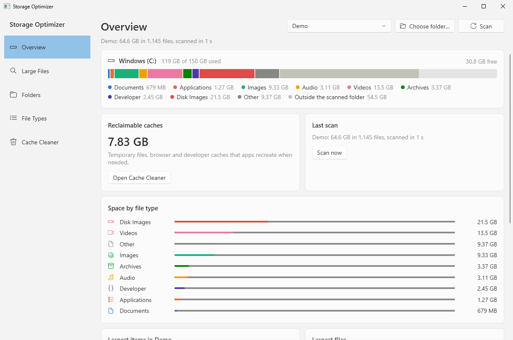
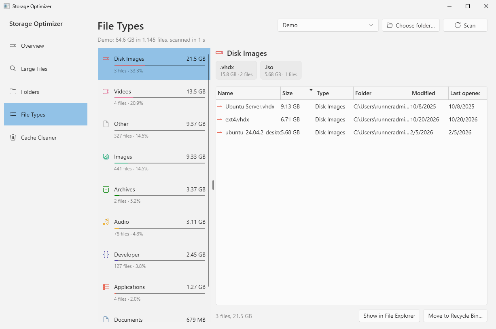
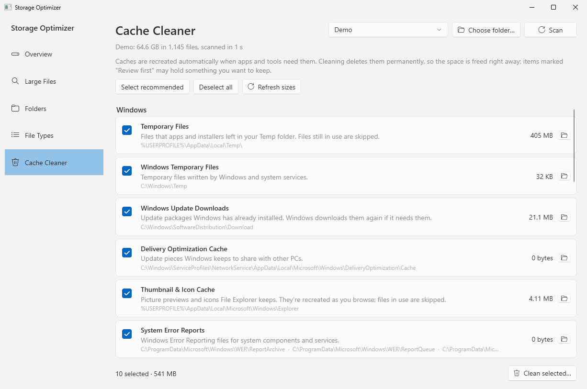

# Storage Optimizer for Windows

The Windows 11 version of Storage Optimizer: a native WPF app on .NET 10 that uses Windows 11's own look (Fluent controls, Mica, light and dark mode). It shows where your disk space went and cleans caches safely. The macOS version is described in the [main README](../README.md).

> [!WARNING]
> This app deletes files and caches when you tell it to. Use it at your own risk and keep backups of anything important. See the [disclaimer](#disclaimer).

<picture>
  <source media="(prefers-color-scheme: dark)" srcset="../docs/screenshots/windows/overview-dark.png">
  
</picture>

## Features

- **Overview**: a drive usage bar broken down by file type, how much space caches are using, and your largest folders and files.
- **Large Files**: a sortable table of the 2,000 largest files.
  - Filter by size, type, name, or files not opened in 6 months.
  - Show items in File Explorer, open them, copy their paths or move them to the Recycle Bin.
- **Folders**: browse the scanned tree, largest first, with size bars and percentages. Files under 1 MB in each folder are grouped into one row.
- **File Types**: space per category (Documents, Applications, Images, Audio, Videos, Archives, Developer, Disk Images, Other), with the largest files and file extensions in each.
- **Cache Cleaner**: finds and measures caches that Windows and your apps rebuild by themselves, then deletes the ones you select:
  - **Windows**: Temp folders, Windows Update downloads, the Delivery Optimization cache, thumbnail and icon caches, crash dumps, error reports, graphics shader caches, the Recycle Bin.
  - **Browsers**: Chrome, Edge, Brave and Firefox caches, for every profile. History, passwords and sign-ins are kept.
  - **Developer tools**:
    - Unity package cache and Asset Store downloads
    - npm, Yarn, pnpm, pip, NuGet, Gradle, Go and Cargo caches
    - Visual Studio, VS Code and JetBrains caches
  - **Project build folders** found by a scan: `node_modules`, Unity `Library`, .NET `bin` and `obj`, Cargo `target`, `.gradle`, Python virtualenvs, `.next`.

You can scan **your user folder**, **any drive** or **any folder** you choose.

## Screenshots

These show the app scanning a demo folder; they're regenerated by the **Screenshots** workflow.

<table>
  <tr>
    <td width="50%">
      <picture>
        <source media="(prefers-color-scheme: dark)" srcset="../docs/screenshots/windows/large-files-dark.png">
        
      </picture>
      <p align="center"><b>Large Files</b></p>
    </td>
    <td width="50%">
      <picture>
        <source media="(prefers-color-scheme: dark)" srcset="../docs/screenshots/windows/folders-dark.png">
        
      </picture>
      <p align="center"><b>Folders</b></p>
    </td>
  </tr>
  <tr>
    <td width="50%">
      <picture>
        <source media="(prefers-color-scheme: dark)" srcset="../docs/screenshots/windows/file-types-dark.png">
        
      </picture>
      <p align="center"><b>File Types</b></p>
    </td>
    <td width="50%">
      <picture>
        <source media="(prefers-color-scheme: dark)" srcset="../docs/screenshots/windows/cache-cleaner-dark.png">
        
      </picture>
      <p align="center"><b>Cache Cleaner</b></p>
    </td>
  </tr>
</table>

## Requirements

- Windows 11 or Windows 10 (version 2004 or later), x64 or ARM64
- Nothing else to install: the app is a single self-contained `.exe`.

## Getting the app

### Download a release

1. Open the [latest release](https://github.com/ugokce/StorageOptimizer/releases/latest).
2. Download `StorageOptimizer-<version>-Windows-x64.zip`, or `StorageOptimizer-<version>-Windows-ARM64.zip` for ARM PCs such as Snapdragon laptops.
3. Unzip it and run `StorageOptimizer.exe`.

The app isn't code-signed, so the first time you run it Windows SmartScreen says **"Windows protected your PC"**. Choose **More info → Run anyway**. If the zip itself is blocked, right-click it, choose **Properties** and tick **Unblock** before extracting.

**Development builds:** every push that changes `windows/` runs the **Windows** workflow on GitHub Actions. To try the latest code before it's released:

1. Open the latest successful **Windows** run on the **Actions** tab.
2. Download the `StorageOptimizer-Windows` artifact.
3. Unzip `StorageOptimizer-win-x64.zip` or `StorageOptimizer-win-arm64.zip` inside it.

### Build it yourself

Install the [.NET 10 SDK](https://dotnet.microsoft.com/download), then:

```powershell
git clone https://github.com/ugokce/StorageOptimizer.git
cd StorageOptimizer\windows

dotnet run --project src\StorageOptimizer.App                     # quick start
dotnet publish src\StorageOptimizer.App -c Release -r win-x64 --self-contained `
  -p:PublishSingleFile=true -p:IncludeNativeLibrariesForSelfExtract=true -o publish
```

You can also open `StorageOptimizer.Windows.sln` in Visual Studio or JetBrains Rider (with .NET 10 support) and run the `StorageOptimizer.App` project.

To run the tests:

```powershell
dotnet test
```

## Administrator items

The app always starts as a normal user. Some cleanup needs administrator rights: Windows Temp, Windows Update downloads, the Delivery Optimization cache and system error reports. These items are greyed out until you click **Restart as administrator** in the Cache Cleaner.

## How deletion works

- **Files and folders** you remove from Large Files, Folders or File Types go to the **Recycle Bin**, so you can restore them.
  - Their space is freed when you empty the Recycle Bin; the Cache Cleaner can do that too.
  - If something is too big for the Recycle Bin, Windows warns you first.
  - Items on network drives are never deleted, because network drives have no Recycle Bin.
- **Caches** are deleted permanently after you confirm, because moving them to the Recycle Bin wouldn't free any space.
  - Only the contents of each cache folder are deleted; the folders themselves stay.
  - Files that are in use are skipped.
  - If one of the affected apps is running, you're told to close it first.
- **Recommended vs. Review First:** recommended targets are selected by default. Targets marked **Review first** are never selected automatically: the Recycle Bin, Unity Asset Store downloads, NuGet packages and the pnpm store.
- **Safety check:** every deletion first passes a check.
  - **Allowed:** items inside your user folder and on other local drives (D:, E:, …).
  - **Always refused:**
    - drive roots
    - `C:\Windows`, Program Files and ProgramData (uninstall apps from **Settings → Apps** instead)
    - other users' folders
    - your user folder's standard folders themselves (Desktop, Documents, Downloads, AppData, OneDrive, …)
    - registry files (`NTUSER.DAT`) and credential stores
    - anything reached through a junction or symbolic link
- **How sizes are counted:**
  - Junctions and symbolic links are never followed during a scan, so nothing is counted twice.
  - OneDrive files that exist only in the cloud count as 0 bytes, because they take no space on this PC.

## Where else your space goes

Some space can't be cleaned by deleting files yourself:

- **Windows.old** and update leftovers: use **Settings → System → Storage → Temporary files**, or Disk Cleanup with "Clean up system files".
- **WSL and Docker**: disks such as `ext4.vhdx` can grow to tens of GB. They appear under Disk Images in Large Files; compact them with `wsl --manage <distro> --set-sparse true` or Docker Desktop's "Clean / Purge data".
- **Hibernation** (`hiberfil.sys`) and the **page file**: these are system-managed; `powercfg /hibernate off` removes the hibernation file if you don't use hibernation.
- **`C:\Windows` sizes look bigger than they are**: many system files are hard-linked into several folders.

## Project layout

```
StorageOptimizer.Windows.sln
src/StorageOptimizer.Core/        Scanner, statistics, cache catalog, cleaner and deletion guard (cross-platform .NET)
src/StorageOptimizer.App/         WPF app (views, view models, Windows integrations, smoke test)
tests/StorageOptimizer.Core.Tests xUnit tests (run on Windows and Linux)
```

The app has two modes for CI:

- **`StorageOptimizer.exe --smoke-test <folder>`** runs on every Windows CI build.
  - It opens the real window and scans a test folder.
  - It shows every page at a normal and at the smallest window size, and checks the layout.
  - It saves a screenshot of each page, published as the `smoke-test-screenshots` artifact.
- **`StorageOptimizer.exe --screenshots <folder>`** is used by the Screenshots workflow to make the images above.
  - It creates a `Demo` folder of sparse files in your user folder and scans it.
  - It saves every page in light and dark mode, then deletes the `Demo` folder.
  - If a `Demo` folder already exists, it refuses to start.

## Disclaimer

Storage Optimizer is provided "as is", without warranty of any kind. It moves files to the Recycle Bin and permanently deletes caches when you ask it to.

The authors and contributors accept no liability or responsibility for any data loss, damage or other harm caused by using it, whether directly or indirectly. You use it entirely at your own risk. Check what you've selected before you delete anything, and keep backups of anything important. The [license](../LICENSE) contains the full terms.
